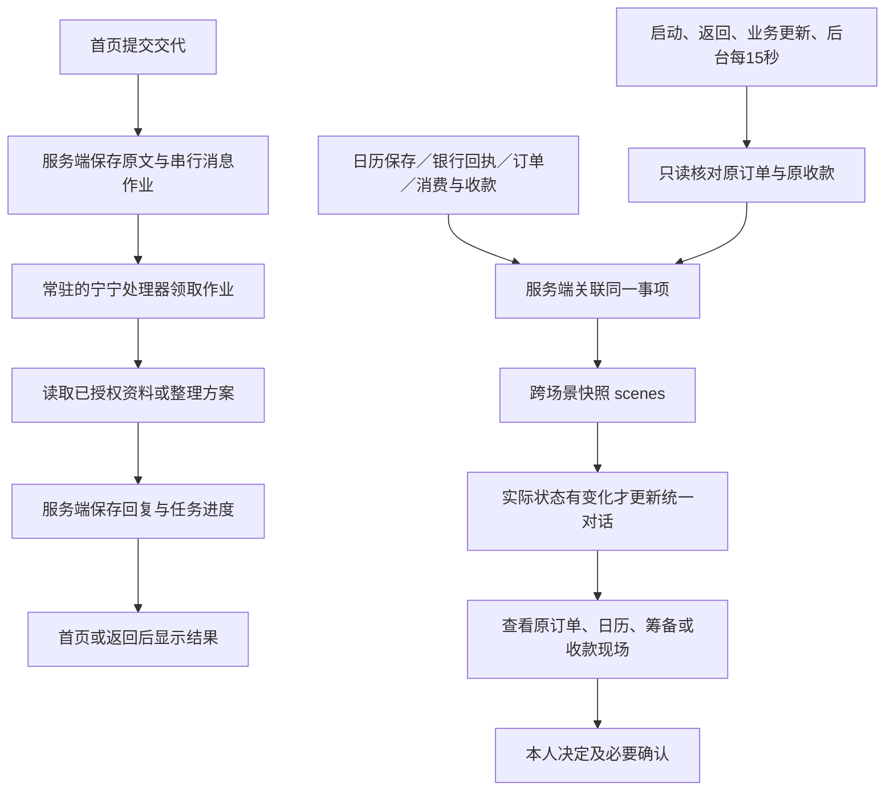

# 跨场景状态、返回续接与后台处理

实现日期：2026-10-12。范围是统一关联同一事项的业务记录、返回自动核对、切换页面或沙箱应用时继续处理。

## 处理链路

## 统一事项的关联依据

`Workspace.sceneId` 指向同一事项的根任务。分类器可以在明确属于同一事件的新处理阶段返回 `relatedTaskId`，例如原生日提醒的后续蛋糕筹备；系统校验父任务存在、处于活动状态、不成环。不同人、不同事件不能仅靠同类标题合并。关联不会重放旧交代，也不产生执行权限。

`WorkspaceState.scenes` 持久保存事项标题、成员任务、业务链接、实际记录、当前阶段、待继续位置、最近平台订单观察和核对失败信息。每条记录保留所属任务及原业务编号：

| 记录 | 关联方式及事实来源 |
| --- | --- |
| 微信来源 | 原任务的所选消息分享材料、对应消息作业 |
| 日历 | 保存或编辑日历时保留 `workspaceId`；生日仍是每年重复的全天日历记录 |
| 筹备与预算 | 银行筹备记录的原 `planId` 等于任务编号 |
| 日常外卖 | 已保存点餐方案里的原 `orderId`，平台回执必须匹配原 `taskId` |
| 筹备外卖 | 原筹备方案的订单链接，平台回执必须匹配原 `occasionId` |
| 消费与微信群收款 | 原任务绑定的账本、原结算批次及验证后的群收款回执 |
| 银行转账、预约与银行AA | 准备方案时传递 `workspaceId`，后续回执继续保存同一关联 |

旧记录保持兼容。缺少明确关联编号的历史日历或银行记录不会仅凭姓名、标题或相近金额自动归入某件事。

## 状态如何决定

消息的 `completed` 只表示回复已保存；事项完成还要看业务记录。事项阶段包括 `processing`、`waiting_user`、`waiting_authorization`、`waiting_external`、`completed`、`cancelled`、`failed`。

待付款订单仍需本人确认；已付款、接单或配送中仍是等待外部结果；已送达的筹备订单还保留本人确认筹备完成的步骤。收款必须逐个验证成员、金额、原分摊方案和付款标记，不能因一条 `completed` 文本就算收齐。预约到期失败如实展示失败原因。

旧订单观察不能把新阶段倒退。重复返回同一回执不重复发通知；消息用事项与状态指纹生成稳定编号。只改变核对时间不新增聊天。状态通知带事项名称，只有当前事项的最新通知提供继续入口。初次尚无平台结果的订单不会立即生成无意义的“状态待核对”通知。

## 返回续接和后台运行

`App` 在首次启用AI原生模式后常驻 `StewardWorkspaces`，离开首页时只隐藏界面，不卸载处理器。消息领取、数据整理、点餐或筹备模型请求及晚到回调继续运行。服务端已经开始的通用回复独立写入正文。

`useSceneContinuation` 在启动、手机前台事件、浏览器focus/visibility恢复、业务更新以及每15秒触发核对。同一时刻只有一轮核对；在途期间发生返回事件会排队再核对一次。较旧快照不能覆盖较新工作区版本。

手机会话桥允许后台读取实际菜单、原订单、已获群授权的原收款，以及仍有授权的账单刷新。新授权、发布收款、准备订单、打开支付和取消订阅仍要求前台相应操作。后台读取不会抢走当前应用焦点。

返回核对只调用 `records`；不会调用 `prepare`、`publish` 或付款。微信群已发布但回调丢失时，核对原批次和原分摊，补存已存在的回执，不再发布。暂时缺失的记录不会删除已经保存的回执或解锁结算；读取失败保留原记录和待核对原因。群授权撤回后不继续读取。

## 文件与接口

- `server/scene-service.ts`：按设备scope关联业务事实，计算状态，保存快照。
- `src/lib/scene-flow.ts`：关联校验、快照类型、对话通知去重。
- `src/lib/scene-service.ts`：原订单及原收款的只读核对、回调丢失恢复。
- `src/lib/use-scene-continuation.ts`：独立于可见页面的串行核对调度。
- `src/App.tsx`、`src/components/steward-workspaces.tsx`：常驻处理器和继续入口。
- `mobilegym/apps/Zhiyin/phone-session.ts`：后台只读边界。
- `/api/zhiyin/scenes`：GET关联本地事实；POST同步经手机桥核对的原订单观察。按现有设备scope隔离、同源访问并限制请求大小。普通工作区写入接口拒绝直接写 `scene-sync`。

## 已验证与使用边界

测试覆盖切页时晚到回复、背景读取仍需已有授权、返回时核对原订单、状态不倒退、归属校验、重复通知、关联与防循环、微信回调丢失恢复、资金和成员回执一致性、网络失败与版本冲突、同源及快照写入边界。

真实浏览器验证发送后立即进入个人中心，消息在后台完成；也验证请求处理中打开原外卖订单，返回知银后完整后台回复仍然存在，输入框已清空。手机测试覆盖隐藏应用仍允许只读核对且拒绝后台新增执行请求。

最终知银回归615项、手机沙箱402项全部通过；类型检查与手机构建通过。新增状态与续接模块覆盖率为行100%、分支82.59%、函数96%；新增模块ESLint与差异空白检查通过。依赖未变更，依赖审计仍报告原有22项问题，本次未自动升级依赖。

“后台”指当前应用/浏览器仍运行时切页面、切沙箱应用。关闭浏览器、系统杀死进程、服务器关闭不是本次新增的离线执行能力。已持久化业务记录会保留；服务重启后中断的消息按现有机制显示重试，不自动重放资金操作。实际手机系统的长时间后台保活、系统推送与服务端外部订单适配尚未实现。
