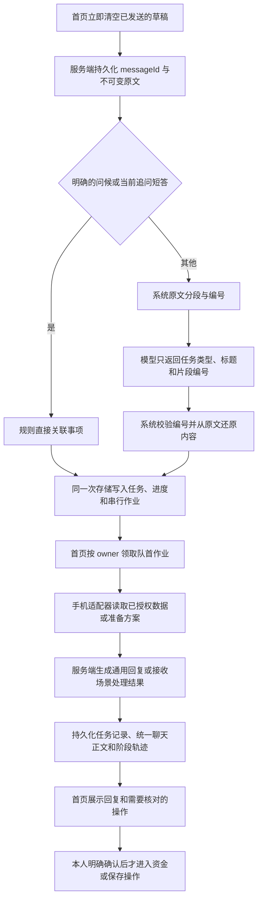

# 宁宁消息处理链路

本次修改针对“发送后没回复”“任务拆分遗漏或改写了原话”以及页面丢失晚到回复。原架构让模型同时分类并复制用户原文；任意复制遗漏都会在校验阶段阻止回复。历史任务和原文又混在模型输入中，短答可能误选任务；浏览器临时队列和两套聊天记录也让失败难以定位。

## 当前链路

- `/api/zhiyin/messages` 管理提交、领取、回复、完成、重试和聊天迁移。仍使用原有按 scope 隔离的工作区文件，不改模型凭据。
- 一个 `messageId` 贯穿原文、用户行、作业、回复和处理轨迹。重复提交不能替换原文；重复回复共用正在进行的模型调用，完成后不会重新产生操作按钮。
- 模型不能填写业务文本。单任务使用完整原文，多任务通过连续且完整的编号覆盖还原；错误编号、未知事项和有歧义的关联仍会拒绝或追问。
- “你好”不再经过模型分类。“对”等短答只在当前事项明确等待回答时直接延续。其他请求仍可能需要分类模型；其空内容最多重试一次，格式校验最多两次。
- 分类追问后，分类器必须明确返回 `continuesClarification`。确为补充时，系统将完整原请求和多轮补充绑定为 `sourcePrompt`，再次分类后交给业务处理；换话题不合并。原用户消息 `prompt` 保持不变。超过 2000 字时要求简短重述，不截掉金额等参数。归属按原始用户消息顺序确定，不受重试队列重排影响，并兼容旧记录缺少 `messageId` 的情况。
- 服务端原子入队，只有队首能领取，领取有 owner 和租约。一项失败则停止该条消息的后续作业，保留原交代和重试提示。不会重启后自动重放转账或下单。
- 首页在分流或回复期间仍可连续发送。提交按点击顺序保存，消息立即清空，正在处理的作业不重置后续草稿。原消息及其回复由提交/完成接口正式写入，避免乐观聊天行先保存却遗漏归属字段。
- 重试发送 `{type:'retry', id:原消息ID, retryId:本次点击ID, memoryRevision}`。成功作业保持不变，仅未完成作业重新入队；失败时释放旧 pending，重试时换新作业令牌，迟到的旧结果不能覆盖新作业。同一 `retryId` 重复请求不再次执行。显式重试排到现有队列末尾，刷新后的旧失败记录也使用此路径。
- 分类可脱离页面继续；已经开始的服务端回复即使页面关闭仍会写入记录。服务重启中的分类以及过期且没有运行中回复的领取会标记中断。
- 手机侧专用流程由常驻处理器提供沙箱授权数据和交互，切页面或沙箱应用时继续运行；返回时自动核对原订单及原收款。新增授权和资金确认仍由本人完成。浏览器关闭或刷新后的未完成领取仍按租约和明确重试恢复，详见 [跨场景续接实现](cross-scene-continuation.md)。
- 服务端按记忆版本过滤任务历史与聊天上下文。没有来源版本的迁移行可以展示，不进入模型上下文；忘记或重置期间的结果不能继续执行。
- 微信生日记录或核对后的短答进入任务日历：从来源核对姓名和公历月日，生成每年重复的全天生日记录，沿用日历保存接口。生日不写入长期记忆，不受记忆开关影响；只有日历实际写入后才显示保存成功。

## 状态与排查

消息状态：`routing → ready → processing → completed`；必要追问为 `waiting_user`，失败为 `failed`，恢复中断为 `interrupted`。`completed` 表示回复已保存，不代表付款、转账、取消或订单已执行。

在当前同源页面请求 `GET /api/zhiyin/messages`，携带已有 `X-Zhiyin-Expense-Scope`。查看该消息的 `runs[].trace`、`decision`、`error` 和 `jobs`：

| 最后阶段 | 含义 |
| --- | --- |
| routing | 规则/分类模型尚未完成，原文已持久化 |
| queued | 作业已保存，等待首页领取 |
| gathering | 首页正在核对授权数据或运行专用场景 |
| replying | 服务端正在请求回复模型 |
| completed | 正文和任务记录均已保存 |
| failed / interrupted | 保留阶段原因和原文，需明确重试 |

模型提示词仍以 `src/prompts/*.v1.md` 为源；`npm run prompts:sync` 生成可同时供浏览器和服务端导入的字符串。标准测试、构建和手机同步会执行生成步骤。

## 2026-10-16 分流修复

- 快捷分流只接收明确属于当前事项的完整短答。金额与时间需要匹配追问，`500字介绍杭州`、`明天天气怎么样` 不能直接进入转账补参。点餐和账单的混合句交由模型分流；中文句号、问号、感叹号可分段，小数金额仍完整保留。
- 账单概念解释不触发查询。`不要`、`不用`、`不需要` 暂停当前查账，立即确认，不等待平台刷新，也不会再次弹出读取授权。
- 分流原文按编号打包、分块发送，保留全部文本。当前事项详情优先；历史索引和其他详情按剩余容量加入，省略数量明确告知模型。请求保留格式重试空间，满足最多 30 条消息、每条最多 2000 字、总 JSON 不超过 32 KiB 的代理约束。索引不完整且指代不明时仍应追问。
- 资金操作仍需要原有核对授权。消息 `completed` 和重试成功只表示本次处理完成，不表示转账或付款已发生。

## 验证范围

回归覆盖不可变原文、多任务顺序、不同页面领取、并发请求去重、错误归属、重启恢复、记忆版本变化、网络未知结果重试、首页草稿保护、续费确认入口和点餐流程。真实模型验证问候、周末建议、短答以及转账与账单混合分类；真实浏览器验证问候和“对”的回复、输入清空和历史展示。资金最终执行不属于这些只读验证。

本轮新增语义边界、长输入容量、多轮澄清、部分失败重试、旧记录兼容及连续发送回归：`npm test` 148 文件 / 875 项通过，`npm run build` 通过并完成手机同步；改动范围 ESLint 无错误，保留 4 个既有 hooks 警告。分流请求模块覆盖率为 96.06% 行 / 86.72% 分支，消息恢复模块为 98.36% 行 / 82.81% 分支（本轮定向覆盖率测量）。

本轮浏览器验收使用临时目录和模拟模型，实际运行消息中间件：连续三句提交、完成后保留下一句草稿、刷新后单独重试失败项；调用记录确认成功项只处理一次。没有执行真实资金操作，也没有对本轮修复做付费模型端到端验证。依赖审计报告 22 项既有问题，本轮未调整依赖。
